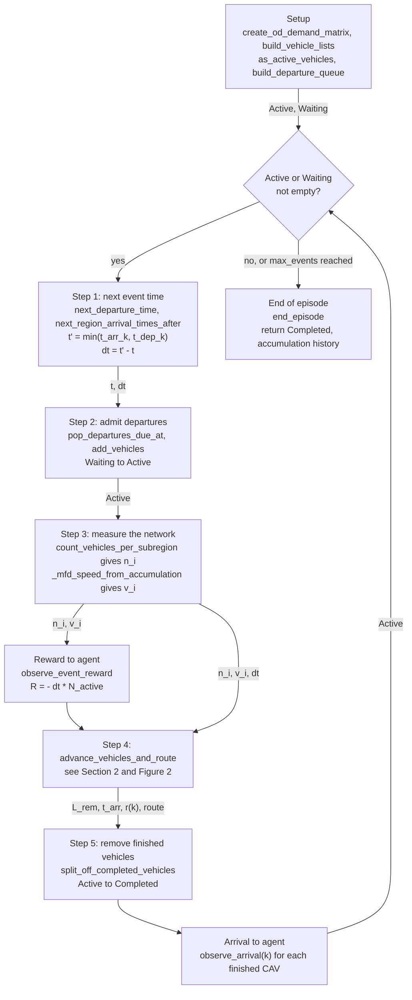
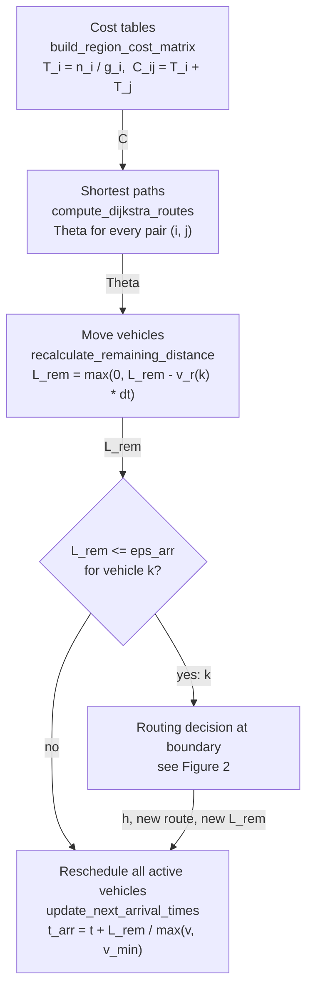
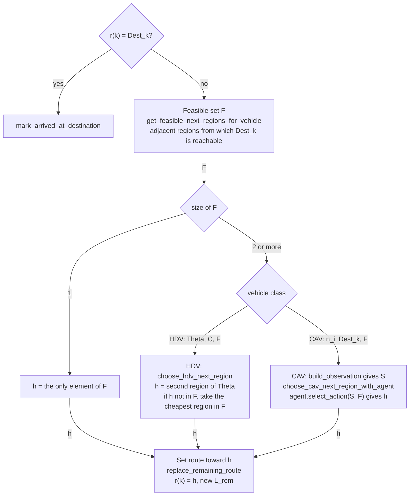

# Simulation engine flowchart

This document shows how data moves through the event loop of the simulation engine. Function names
are those of `scripts/RG_MFD_simplified/rg_mfd_simplified/`. Symbols follow Chapters 3 and 4 of the
report (`RG_MFD_Report_2026-11-24.pdf`). A shorter version is in
[`simplified_flowchart.md`](simplified_flowchart.md).

## 1. Main event loop

Time does not advance in fixed steps. Each pass of the loop jumps to the next event: a departure or
a vehicle finishing a leg in a region.

## 2. Step 4 in detail: advance_vehicles_and_route

Costs are rebuilt once per event, before any vehicle is asked for a decision. Then every active
vehicle moves, and only the vehicles whose leg has just ended make a routing decision.

## 3. Routing decision at a region boundary

Applied to each vehicle `k` whose leg has ended. HDVs follow the shortest path. CAVs ask the agent.

If `F` is empty, no region is chosen and the vehicle is routed straight toward its destination.

## 4. Variables

| Symbol | Name in code | Meaning | Units |
|---|---|---|---|
| $t$, $\Delta t$ | `current_time`, `prev_time` | Simulation time and the time since the previous event | s |
| $t_k^{dep}$ | departure queue entry | Departure time of vehicle $k$ | s |
| $t_k^{arr}$ | next arrival time | Time vehicle $k$ is expected to finish its current leg | s |
| $n_i$ | `sub_n[i]` | Accumulation of region $i$ (vehicles inside) | veh |
| $v_i$ | `speed[i]` | Speed in region $i$, $v_i = \max\big(l_i(\delta_1 n_i^2 + \delta_2 n_i + \delta_3)\,\varphi(\rho)\,\sigma,\ v_{min}\big)$ | m/s |
| $g_i$ | production over trip length | Trip completion rate of region $i$ | veh/s |
| $T_i$ | region travel time | Average travel time, $T_i = n_i / g_i$ | s |
| $C_{ij}$ | cost matrix | Edge cost, $C_{ij} = T_i + T_j$ if regions $i$ and $j$ are adjacent, otherwise $\infty$ | s |
| $\Theta$ | shortest path | Sequence of regions on the cheapest path over $C$ | regions |
| $L_k^{rem}$ | remaining distance | Distance vehicle $k$ still has to cover on its current leg | m |
| $\varepsilon_{arr}$ | `ARRIVAL_TOL` | A leg counts as finished once $L_k^{rem} \le \varepsilon_{arr}$ | m |
| $v_{min}$ | `MIN_SPEED` | Speed floor, 0.5 m/s | m/s |
| $r(k)$ | current region | Region vehicle $k$ currently occupies | region index |
| $\mathit{Dest}_k$ | destination region | Destination of vehicle $k$ | region index |
| $F$ | feasible regions | Legal next regions for vehicle $k$ | set |
| $S$ | `observation` | 28-dimensional CAV state: current region (7), destination (7), $n_i / n_{max,i}$ (7), action mask (7) | none |
| $h$ | chosen region | Next region selected for vehicle $k$ | region index |
| $R$ | event reward | Reward passed to the agent after each event, $-\Delta t \cdot N_{active}$ | veh·s |
| $\varphi(\rho)$, $\sigma$ | penetration factor, speed scale | CAV-share correction and unit scale of the MFD | none |

## 5. Functions

| Function | File | Receives | Returns |
|---|---|---|---|
| `run_episode` | `simulation.py` | data directory, agent, seed, demand scale | Completed vehicles, event count, elapsed time |
| `create_od_demand_matrix` | `demand.py` | configuration | OD demand matrix |
| `build_vehicle_lists` | `travelers.py` | demand, initial accumulation, speeds | Initial vehicles and the two departure lists |
| `build_departure_queue` | `simulation.py` | vehicle list | Vehicles sorted by $t^{dep}$ |
| `next_departure_time` | `simulation.py` | queue, $t$ | Next departure time |
| `pop_departures_due_at` | `simulation.py` | queue, $t$ | Vehicles departing at $t$ |
| `count_vehicles_per_subregion` | `simulation.py` | active vehicles | $n_i$ |
| `build_region_cost_matrix` | `routing.py` | $n_i$, region parameters | $C$ |
| `compute_dijkstra_routes` | `routing.py` | adjacency, $n_i$, $C$ | Shortest paths $\Theta$ per pair |
| `advance_vehicles_and_route` | `simulation.py` | active vehicles, $t$, $\Delta t$, $v_i$, $n_i$ | Updated active vehicles |
| `get_feasible_next_regions_for_vehicle` | `path_choice.py` | vehicle | $F$ |
| `choose_hdv_next_region` | `path_choice.py` | vehicle, $F$, paths | $h$ |
| `build_observation` | `simulation.py` | vehicle, $n_i$, action mask | $S$ |
| `choose_cav_next_region_with_agent` | `path_choice.py` | vehicle, $S$, $F$, agent | $h$ |
| `split_off_completed_vehicles` | `simulation.py` | active vehicles, $t$ | Completed vehicles, remaining active vehicles |
