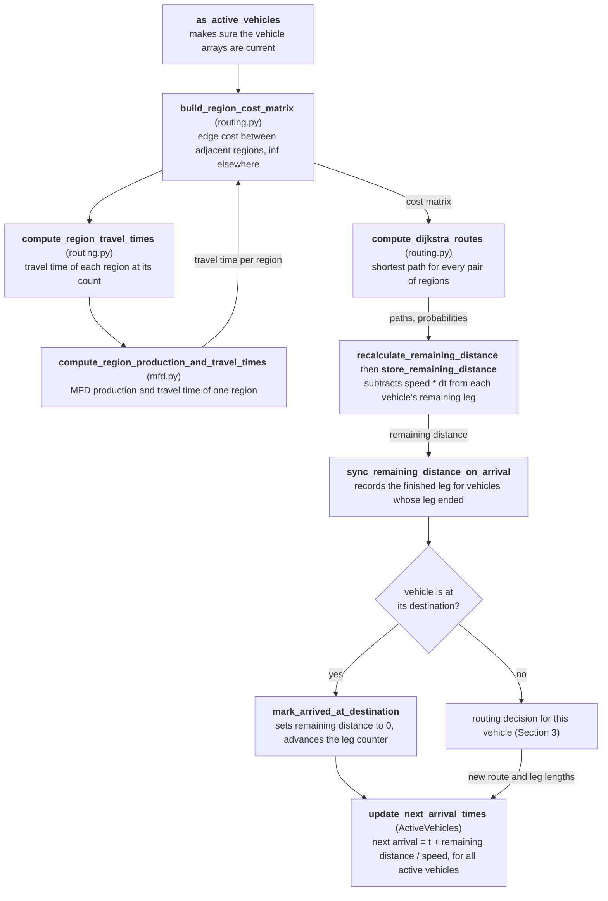
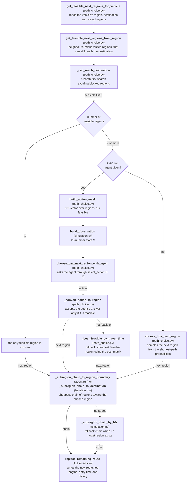

# Codebase flowchart

Technical view of the simulation engine: which function is called, in which order, what it does, and
what it passes on. Names are those of `scripts/RG_MFD_simplified/`. The mathematical view of the same
loop, without function names, is in [`simplified_flowchart.md`](simplified_flowchart.md).

Files: `simulation.py`, `routing.py`, `path_choice.py`, `mfd.py`, `demand.py`, `travelers.py` are in
`rg_mfd_simplified/`. `iql_agent.py` and `ppo_agent.py` are in the package root.

## 1. `run_episode`: setup and event loop

```mermaid
flowchart TD
    S1["<b>build_simulation_config</b> (config.py)<br/>reads mfd.json, builds region graph and parameters"]
    S2["<b>create_od_demand_matrix</b> (demand.py)<br/>builds the origin-destination demand Q"]
    S3["<b>load_mat_file</b> (matlab_io.py)<br/>loads initial accumulation xInit"]
    S4["<b>build_vehicle_lists</b> (travelers.py)<br/>creates vehicles with origin, destination, departure time, route"]
    S5["<b>as_active_vehicles</b> (simulation.py)<br/>wraps the vehicles on the road at t = 0 in an ActiveVehicles store"]
    S6["<b>build_departure_queue</b> (simulation.py)<br/>sorts not-yet-departed vehicles by departure time"]
    L0{"active or queues<br/>not empty, and<br/>events below max_events?"}
    L1["<b>next_departure_time</b> (simulation.py)<br/>earliest departure in a queue"]
    L2["<b>next_region_arrival_times_after</b> (ActiveVehicles)<br/>earliest finish of a current leg"]
    L3["<b>pop_departures_due_at</b> then <b>add_vehicles</b><br/>moves vehicles departing now into the active store"]
    L4["<b>count_vehicles_per_subregion</b> (ActiveVehicles)<br/>counts active vehicles per region, gives n"]
    L5["<b>_mfd_speed_from_accumulation</b> (simulation.py)<br/>speed of each region from its count, floored at MIN_SPEED"]
    L6["<b>observe_event_reward</b> (agent)<br/>receives - dt * active vehicles"]
    L7["<b>advance_vehicles_and_route</b> (simulation.py)<br/>moves vehicles and re-routes those at a boundary (Section 2)"]
    L8["<b>split_off_completed_vehicles</b> (ActiveVehicles)<br/>separates vehicles that reached their destination"]
    L9["<b>observe_arrival</b> (agent)<br/>called for each finished CAV"]
    E1["<b>end_episode</b> (agent)<br/>closes open transitions, PPO updates here"]
    E2["returns vehicles, total_vehicles, events, sim_time"]

    S1 --> S2 --> S3 --> S4 --> S5 --> S6 --> L0
    S4 -->|"vehicle lists"| S5
    L0 -->|"yes"| L1
    L0 -->|"no"| E1
    L1 -->|"t_int, t_ext"| L2
    L2 -->|"t_next = min of the three times"| L3
    L3 -->|"active store"| L4
    L4 -->|"sub_n"| L5
    L5 -->|"speed"| L6
    L6 --> L7
    L7 -->|"updated active store"| L8
    L8 -->|"done, active"| L9
    L9 --> L0
    E1 --> E2
```

## 2. `advance_vehicles_and_route`

Called once per event. It first prices the network, then moves every vehicle, then decides routes for
the vehicles whose leg has ended.

## 3. Routing decision for one vehicle

## 4. Function reference

| Function | File | What it does | Receives | Returns |
|---|---|---|---|---|
| `run_episode` | `simulation.py` | Runs one episode from setup to the last vehicle | data directory, agent, seed, demand scale, max events | vehicles, total_vehicles, events, sim_time |
| `build_simulation_config` | `config/config.py` | Builds the configuration: region graph, MFD parameters, penetration | network directory | `SimulationConfig` |
| `create_od_demand_matrix` | `demand.py` | Builds the origin-destination demand | configuration, data directory | demand matrix |
| `load_mat_file` | `matlab_io.py` | Reads a `.mat` input file | path | dictionary of arrays |
| `build_vehicle_lists` | `travelers.py` | Creates vehicles and splits them into initial, internal and external departures | demand, initial accumulation, speeds | three vehicle lists |
| `as_active_vehicles` | `simulation.py` | Wraps vehicle records in the `ActiveVehicles` store | vehicle list | `ActiveVehicles` |
| `build_departure_queue` | `simulation.py` | Sorts vehicles by departure time | vehicle list | queue |
| `next_departure_time` | `simulation.py` | Earliest departure still in a queue | queue, time | time |
| `pop_departures_due_at` | `simulation.py` | Removes and returns vehicles departing at the current time | queue, time | vehicles |
| `ActiveVehicles.add_vehicles` | `simulation.py` | Appends departing vehicles to the active store | vehicles | none |
| `ActiveVehicles.next_region_arrival_times_after` | `simulation.py` | Next leg-finish times later than now | time | array of times |
| `ActiveVehicles.count_vehicles_per_subregion` | `simulation.py` | Counts active vehicles per region | none | array $n_i$ |
| `_mfd_speed_from_accumulation` | `simulation.py` | Region speed from accumulation through the MFD | region parameters, count | speed |
| `compute_cav_penetration_factor` | `mfd.py` | Penetration factor $\varphi(\rho)$ | $\delta_4, \delta_5, \delta_6$, CAV share | factor |
| `advance_vehicles_and_route` | `simulation.py` | One event: price network, move vehicles, route those at a boundary | active store, times, speeds, counts, agent | updated active store |
| `build_region_cost_matrix` | `routing.py` | Edge cost $C_{ij} = T_i + T_j$ for adjacent regions, infinity otherwise | adjacency, counts | matrix |
| `compute_region_travel_times` | `routing.py` | Average travel time $T_i$ of every region | counts, region parameters | array |
| `compute_region_production_and_travel_times` | `mfd.py` | Production, average and system-optimal travel time of one region | count, parameters | three numbers |
| `_mfd_speed_kernel` | `mfd.py` | Compiled numeric kernel behind the line above | count, coefficients | numbers |
| `compute_dijkstra_routes` | `routing.py` | Shortest path for every pair of regions | adjacency, counts | paths, probabilities |
| `_single_source_dijkstra` | `routing.py` | Dijkstra from one region | cost matrix, source | distances, parents |
| `_reconstruct_path` | `routing.py` | Builds the path from the parent array | parents, source, target | list of regions |
| `shortest_path_and_cost` | `routing.py` | Path and cost between two regions | cost matrix, source, target | path, cost |
| `choose_region_path` | `routing.py` | Picks a path for a vehicle in a baseline run | paths, probabilities | path |
| `ActiveVehicles.recalculate_remaining_distance` | `simulation.py` | Remaining leg distance after moving for $\Delta t$ | speeds, dt | array |
| `ActiveVehicles.store_remaining_distance` | `simulation.py` | Writes the new remaining distances for active vehicles | array, mask | none |
| `ActiveVehicles.sync_remaining_distance_on_arrival` | `simulation.py` | Stores the finished leg's remainder in the vehicle record | vehicle index | none |
| `ActiveVehicles.mark_arrived_at_destination` | `simulation.py` | Closes the last leg and advances the leg counter | vehicle index | none |
| `get_feasible_next_regions_for_vehicle` | `path_choice.py` | Feasible set $F$ for a vehicle | vehicle, config | list of regions |
| `get_feasible_next_regions_from_region` | `path_choice.py` | Feasible set from a region, destination and blocked regions | region, destination, blocked | list of regions |
| `_can_reach_destination` | `path_choice.py` | Reachability test avoiding blocked regions | start, destination, graph, blocked | true or false |
| `build_action_mask` | `path_choice.py` | 0/1 vector marking feasible regions | feasible list, region count | array |
| `build_observation` | `simulation.py` | The 28-number state $S$ | vehicle, counts, mask, config | array |
| `choose_cav_next_region_with_agent` | `path_choice.py` | Next region for a CAV from the agent, with a cost-based fallback | vehicle, state, feasible, agent | region |
| `_ask_agent_for_action` | `path_choice.py` | Calls `select_action` on the agent | agent, vehicle, state, feasible, mask | action |
| `_convert_action_to_region` | `path_choice.py` | Checks the action is a feasible region | action, feasible | region or none |
| `_best_feasible_by_travel_time` | `path_choice.py` | Cheapest feasible region by edge cost plus remaining shortest path | vehicle, feasible, state | region |
| `choose_hdv_next_region` | `path_choice.py` | Next region from the shortest-path probabilities | vehicle, feasible, network state | region |
| `_sample_from_probabilities` | `path_choice.py` | Draws a region from probabilities | feasible, probabilities, random state | region |
| `_subregion_chain_to_region_boundary` | `simulation.py` | Cheapest chain of regions to the boundary of the chosen region | position, destination, target, speeds | chain |
| `_subregion_chain_to_destination` | `simulation.py` | Cheapest chain of regions to the destination, leaving by the chosen region | position, destination, target, speeds | chain |
| `_subregion_chain_by_bfs` | `simulation.py` | Breadth-first chain between two regions | start, end, adjacency | chain |
| `ActiveVehicles.replace_remaining_route` | `simulation.py` | Replaces the rest of the route and updates the vehicle's history | index, chain, leg lengths, time | none |
| `ActiveVehicles.update_next_arrival_times` | `simulation.py` | Next arrival time for all active vehicles | speeds, time | none |
| `ActiveVehicles.split_off_completed_vehicles` | `simulation.py` | Separates vehicles that finished their route | time | completed, still active |
| `select_action` | `iql_agent.py`, `ppo_agent.py` | Agent chooses the next region and opens a transition | vehicle, state, feasible, mask | region |
| `observe_event_reward` | agent | Adds the event reward to every open transition | reward | none |
| `observe_arrival` | agent | Closes the transition of a finished CAV | vehicle | none |
| `end_episode` | agent | Discards unfinished transitions, PPO updates here | none | none |
