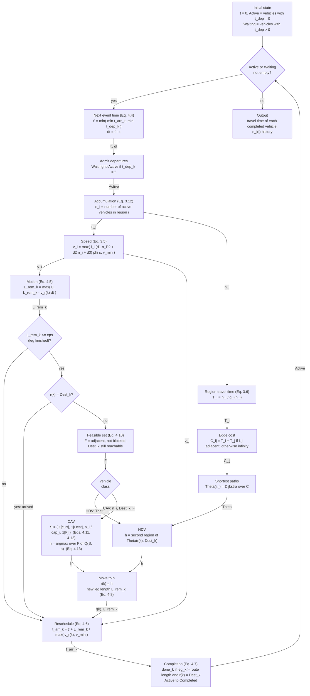

# Math and logic flowchart

The simulation as a sequence of calculations: what is computed, from what, and what is passed on. No
function names appear here. The codebase view of the same loop is in
[`SIMULATION_FLOWCHART.md`](SIMULATION_FLOWCHART.md). Equation numbers refer to the report
(`RG_MFD_Report_2026-11-24.pdf`).

## 1. One event

If $|F| = 1$ that region is taken without consulting the policy. If $F$ is empty no region is
chosen, and the vehicle is routed straight toward its destination.

## 2. Equations in order

$$t' = \min\Big(\min_k t^{arr}_k,\ \min_k t^{dep}_k\Big), \qquad \Delta t = t' - t \tag{Eq. 4.4}$$

$$n_i(t) = \big|\{\,k \in \mathit{Active} : r(k) = i\,\}\big| \tag{Eq. 3.12}$$

$$v_i(n) = \max\Big(l_i\left(\delta_1 n^2 + \delta_2 n + \delta_3\right)\varphi(\rho)\,\sigma,\ v_{min}\Big) \tag{Eq. 3.5}$$

$$T_i(n) = \frac{n}{g_i(n)} \tag{Eq. 3.6}$$

$$C_{ij} = T_i + T_j \quad \text{for adjacent } i, j, \qquad C_{ij} = \infty \text{ otherwise}$$

$$L^{rem}_k(t + \Delta t) = \max\big(0,\ L^{rem}_k(t) - v_{r(k)}\,\Delta t\big) \tag{Eq. 4.5}$$

$$F(i, \mathit{Dest}) = \{\,h : h \text{ adjacent to } i \text{ and not blocked, } \mathit{Dest} \text{ reachable from } h\,\} \tag{Eq. 4.10}$$

$$a^* = \arg\max_{a \in F(i, \mathit{Dest})} Q(S, a) \tag{Eq. 4.13}$$

$$t^{arr}_k = t + \frac{L^{rem}_k}{\max(v_{r(k)},\ v_{min})} \tag{Eq. 4.6}$$

$$\text{done}_k \iff \big(\text{leg}_k > |\text{route}_k|\big) \wedge \big(r(k) = \mathit{Dest}_k\big) \tag{Eq. 4.7}$$

The blocked set contains the regions the vehicle has already visited. If that leaves $F$ empty, the
blocked set is dropped for that decision. The reward passed to the agent after each event is
$-\Delta t \cdot N_{active}$, where $N_{active} = |\mathit{Active}|$.

## 3. Variables

| Symbol | Meaning | Units |
|---|---|---|
| $t$, $\Delta t$ | Simulation time, time since the previous event | s |
| $t^{dep}_k$, $t^{arr}_k$ | Departure time of vehicle $k$, time it finishes its current leg | s |
| $r(k)$ | Region vehicle $k$ occupies | region index |
| $\mathit{Dest}_k$ | Destination region of vehicle $k$ | region index |
| $n_i$ | Accumulation of region $i$ | veh |
| $v_i$, $v_{min}$ | Speed in region $i$, speed floor (0.5 m/s) | m/s |
| $l_i$ | Mean trip length in region $i$ | m |
| $\delta_1, \ldots, \delta_6$ | MFD coefficients | none |
| $\varphi(\rho)$, $\sigma$ | CAV-penetration factor, unit scale | none |
| $g_i$ | Trip completion rate of region $i$ | veh/s |
| $T_i$ | Average travel time in region $i$ | s |
| $C_{ij}$ | Cost of moving from region $i$ to adjacent region $j$ | s |
| $\Theta(i, j)$ | Shortest path from $i$ to $j$ over $C$ | regions |
| $L^{rem}_k$ | Distance vehicle $k$ still has to cover on its current leg | m |
| $\varepsilon$ | Arrival tolerance, $10^{-4}$ m | m |
| $F$ | Feasible next regions | set |
| $S$ | CAV state: current region (7), destination (7), $n_i / \mathrm{cap}_i$ (7), mask (7) | none |
| $Q(S, a)$ | Learned value of choosing region $a$ in state $S$ | none |
| $h$ | Next region chosen | region index |
