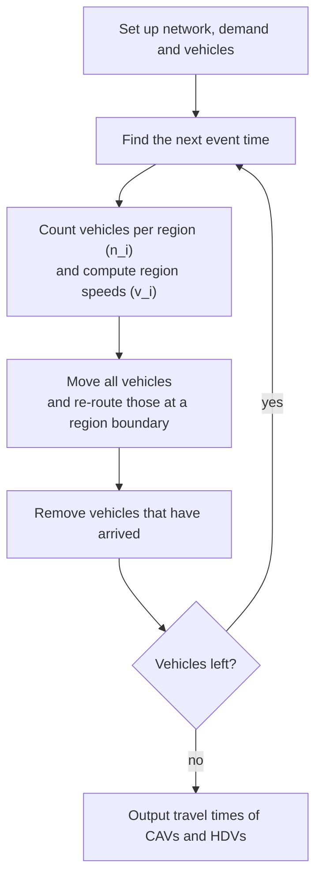

# Simplified flowchart

A short view of one simulation episode. The detailed version, with function names and variables
passed between steps, is in [`SIMULATION_FLOWCHART.md`](SIMULATION_FLOWCHART.md).

At a region boundary a vehicle picks its next region:

- **HDV:** takes the second region of the shortest path over the cost matrix $C_{ij} = T_i + T_j$, with $T_i = n_i / g_i$.
- **CAV:** passes its state $S$ (current region, destination, densities $n_i / n_{max,i}$, legal moves) to the routing agent, which returns the next region.

| Symbol | Meaning |
|---|---|
| $n_i$ | Number of vehicles in region $i$ |
| $v_i$ | Speed in region $i$, a function of $n_i$ |
| $T_i$ | Average travel time of region $i$ |
| $C_{ij}$ | Cost of moving from region $i$ to region $j$ |
| $S$ | State seen by a CAV when it chooses the next region |
